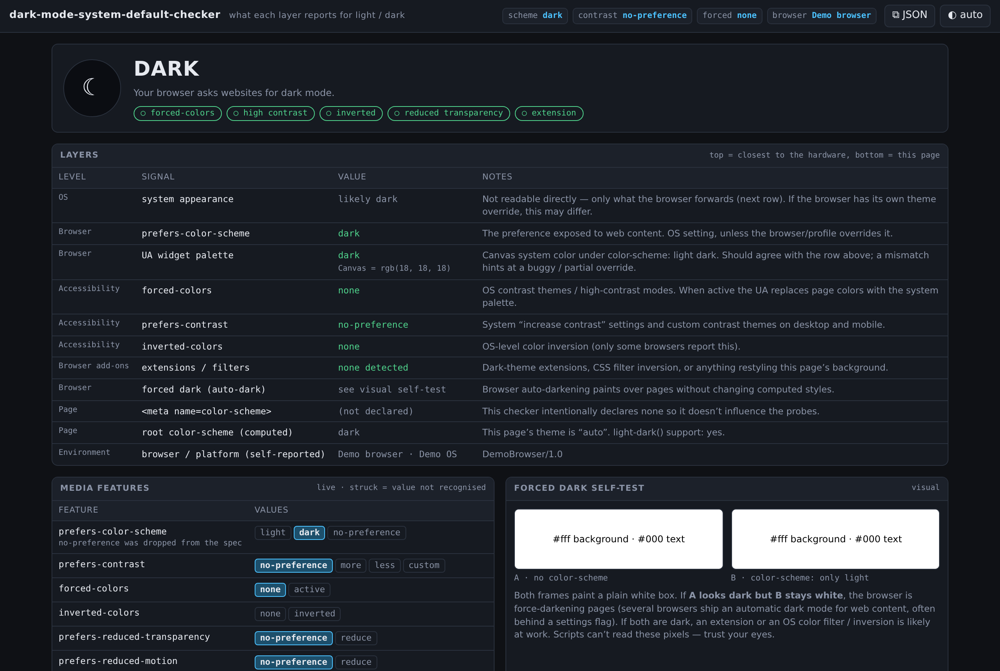
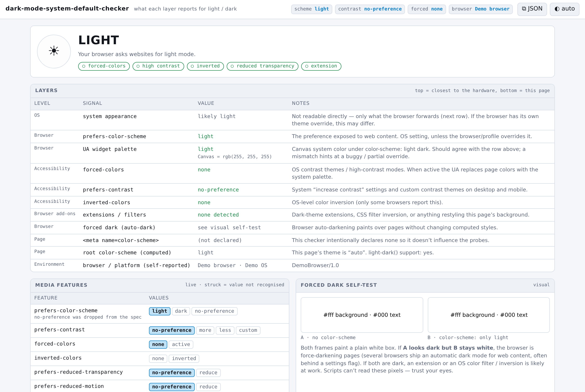
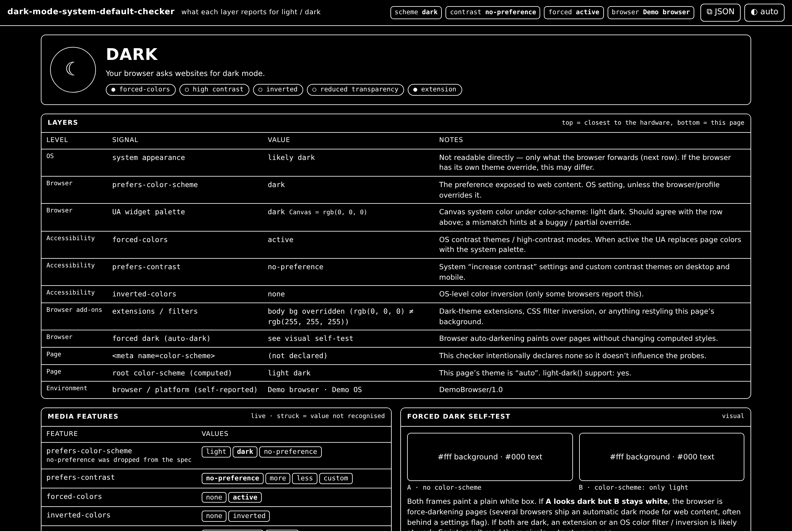
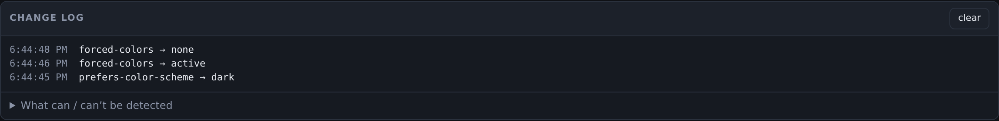
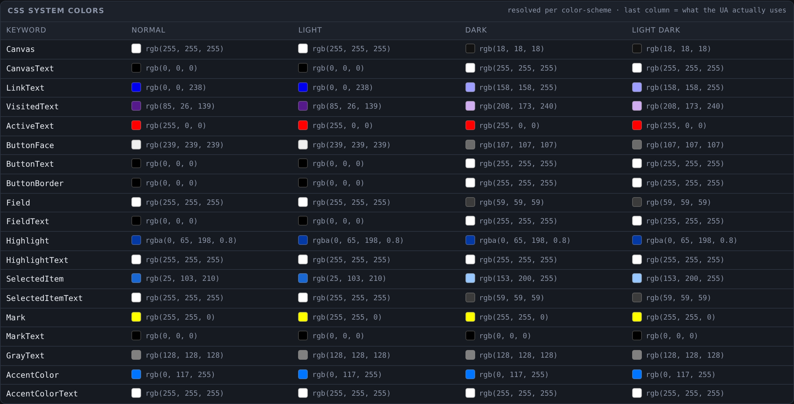
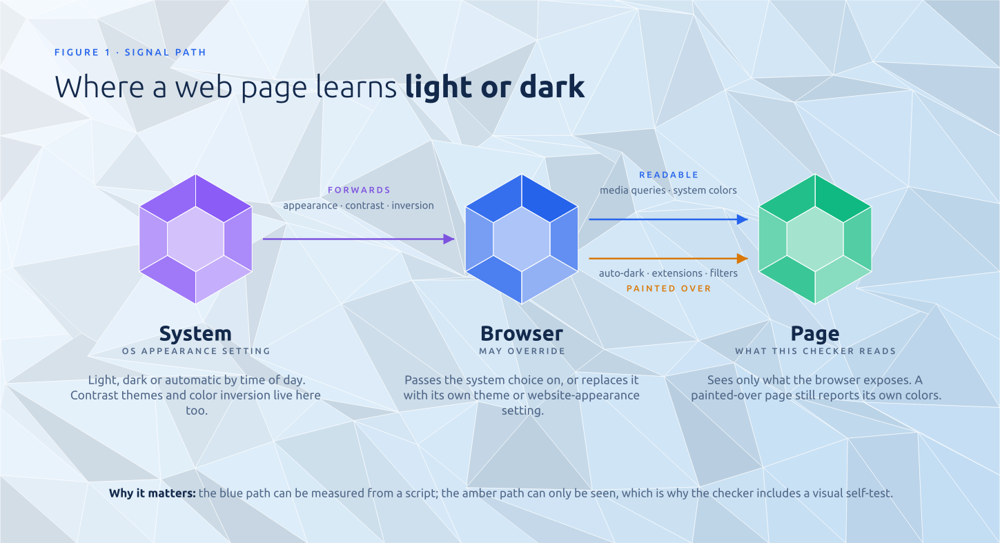
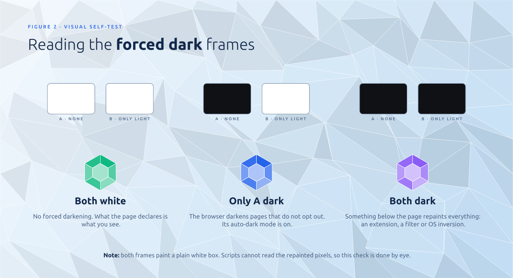

# Dark Mode System Default Checker

Is dark mode really on? This free online dark mode test shows whether your
browser asks websites for a light or dark color scheme, and which layer of
your setup made that call. It reads the `prefers-color-scheme` media query
live, checks contrast and forced-colors settings, and resolves the CSS
system colors your browser uses for built-in controls. A visual self-test
reveals automatic "force dark" modes that no script can detect.

Use it online at <https://html-js.github.io/dark-mode-system-default-checker/>
or download `index.html` and open it from disk. It is one static page with
no build step and no sign-up. Every reading happens inside your browser and
nothing is sent anywhere.



<details>
<summary>More screenshots: light mode, forced colors, change log, system colors</summary>

With the system set to light:



With a high-contrast theme forcing colors (the page switches to the system
palette and the forced-colors flag lights up):



The change log after switching the appearance while the page was open:



The CSS system colors table, resolved once per color scheme:



The screenshots were taken with a neutral demo identity, so the browser
row reads "Demo browser". On your machine it shows what your browser
reports about itself.

</details>

## What questions does it answer?

People usually arrive here with one of a handful of puzzles. Does my
browser support dark mode for websites at all? Why does one site appear
dark while my system is set to light? Why does my own site ignore the dark
theme I wrote? Is high contrast mode changing my colors? Did an extension
repaint the page?

The checker answers these by reading every signal a web page can see,
grouping them by where they come from, and pointing out where two layers
disagree. It is useful for everyday users who just want to confirm a
setting, for support staff collecting details from a customer, and for web
developers debugging a theme switch.

## How to check if dark mode is enabled in your browser

Open the page. The large verdict at the top says LIGHT or DARK, with a sun
or moon badge next to it. Below the word is one plain sentence such as
"Your browser asks websites for dark mode." That sentence is the value
every website receives through the color-scheme media query, so it is the
setting that decides whether sites with a dark theme will use it.

If you change your system appearance or your browser theme while the page
is open, the verdict updates on its own. You do not need to reload. Each
change is also written to the change log near the bottom, with the time it
happened, so you can confirm that toggling a setting really reached the
browser.

Under the verdict sit five small flags: forced colors, high contrast,
inverted, reduced transparency and extension. A hollow circle means the
signal is off. A filled circle in amber means it is on, and that it may be
changing colors on top of the light or dark choice.

## Reading the layers table

The layers table is the heart of the tool. It lists each place that can
influence light or dark, from the one closest to the hardware at the top to
this page itself at the bottom, and shows what each one reports.



The first row is the operating system. Web pages cannot read the system
appearance setting directly, so this row is an inference from the browser
row beneath it, and it says "likely dark" or "likely light". If your
browser has its own theme override, the real system setting may differ.

The second row is the browser preference, the value of
`prefers-color-scheme`. This is what websites actually get. Most browsers
pass the system setting through unchanged, and many also offer their own
appearance or website-theme option that replaces it.

The third row reads the browser's widget palette. It resolves the `Canvas`
system color under `color-scheme: light dark`, which is the background the
browser would paint for its own form controls and scrollbars. In a healthy
setup this agrees with the preference above it. When the two disagree, the
verdict adds a short note, and you are probably looking at a partial or
buggy override somewhere in the browser.

Three accessibility rows follow. Forced colors turns active when a contrast
theme makes the browser replace page colors with a fixed system palette.
Contrast preference reports "more", "less" or "custom" when you asked the
system for stronger or weaker contrast. Inverted colors reports system-wide
color inversion, which only some browsers expose.

The add-ons row looks for signs that something restyled this page after it
loaded. It checks for markers that common dark-theme extensions leave on
the page, for CSS filters on the root elements, and for a body background
that no longer matches the color the page asked for.

The forced dark row always says "see visual self-test", because automatic
darkening cannot be measured from a script. More on that below.

The last rows describe the page itself. The checker declares no color-scheme
meta tag on purpose, so it cannot nudge the readings. You also see the
computed root color scheme, whether the `light-dark()` CSS function is
supported, and the browser name and platform exactly as the browser
reports them.

## Why is a website dark when my system is light?

This is the most common surprise, and the checker can usually explain it.
First look at the verdict. If it says DARK while your system is light, the
browser is overriding the system preference, and the fix lives in the
browser's appearance or theme settings.

If the verdict says LIGHT but pages still look dark, something is painting
over them. Scroll to the forced dark self-test and compare the two frames.
The answer is almost always one of the cases described in the next section.

The opposite case works the same way. When you have chosen dark everywhere
and a site stays bright, check the verdict first. If it already says DARK,
the site simply has no dark theme, or it chose to ignore the preference.

## Forced dark mode test: reading the two frames

Some browsers can darken any web page automatically, even pages that never
offered a dark theme. Extensions and operating system filters can do
something similar. None of these change the colors a script can read back,
so the only reliable check is to look.

The self-test card shows two small frames. Both paint a plain white box
with black text. Frame A declares no color scheme at all. Frame B declares
`color-scheme: only light`, which asks the browser to leave it alone.



If both frames are white, nothing is forcing dark mode, and what a page
declares is what you see. When frame A is dark and frame B stays white, the
browser's automatic dark mode for web content is switched on. It respects
the opt-out in frame B and darkens everything else. If both frames are
dark, the repainting happens below the page, usually in an extension or
through color inversion in the operating system.

## Testing high contrast mode and forced colors

When a contrast theme is active, the browser swaps page colors for a small
set of system colors. The checker shows this in three places at once: the
forced-colors flag under the verdict, the forced-colors row in the layers
table, and the "active" value in the media features panel. The whole page
also redraws in the system palette, which is a useful confirmation by
itself.

Under forced colors the add-ons row will often report that the body
background was overridden, and the extension flag lights up. That is
expected. The browser replaced the page background, which is exactly what
the check looks for, so the reading tells you the page was repainted even
though no extension was involved.

## Media features panel

The media features panel lists every user-preference media query the page
knows about, with all of its possible values. The value that currently
matches is highlighted. A value your browser does not recognize is struck
through, and a feature it does not support at all says "not supported".
The panel updates live, and a row briefly flashes when its value changes.

Covered features include the color scheme and contrast preferences, forced
colors, inverted colors, reduced transparency and reduced motion. The panel
also covers monochrome displays, color gamut, dynamic range for both the
page and video, and a legacy vendor-prefixed high-contrast query that a few
older browsers still answer.

This panel is handy when you want to know whether a particular preference
exists in your browser before you build a design around it.

## CSS system colors table

CSS defines named system colors such as `Canvas`, `CanvasText`,
`ButtonFace`, `Highlight` and `AccentColor`. Their actual values depend on
the browser, the platform, and the color scheme in effect. The system
colors table resolves each keyword four times: with no color scheme, under
light, under dark, and under `light dark`. Each cell shows a swatch next to
the computed RGB value.

The last column is the one that matters most for real pages. It shows the
palette the browser picks when a page says it supports both schemes, which
is what your form controls, scrollbars and selection colors will look like.
Keywords your browser does not support are marked as such.

## Change log: watch the setting change live

Leave the page open and flip your appearance setting. Each media feature
that moves is logged with a timestamp and the value it moved to. If an
extension restyles the page after it loads, that is logged too, along with
the moment the override goes away. The clear button empties the log.

This is a quick way to confirm that a scheduled light and dark switch, or a
keyboard shortcut for your theme, actually reaches web pages.

## Copy the report as JSON

The JSON button in the header copies a complete reading to your clipboard.
It holds a timestamp and the verdict, plus the value of every media feature
and the resolved system colors. It also includes the add-on findings, the
page-level details, and the browser identity. If clipboard access is
blocked, the report is printed to the browser console instead.

Support teams can ask a customer for this report instead of a list of
screenshots. Before you share it anywhere public, read the privacy notes
further down, since the report includes your user-agent string and
platform name.

## Page theme button

The button with the half-filled circle cycles this page's own theme through
auto, light and dark. Auto follows your preference. The other two pin the
page to one look, which helps when you want to read a dark-mode result on a
light page or the other way round. Your choice is remembered in local
storage on your device.

The page theme only changes how the checker is drawn. It does not affect
any of the readings, since every probe resolves colors in its own isolated
context.

## For web developers: using the results

If your site's dark theme does not kick in, compare what you wrote against
what the checker reports. A dark theme normally hangs off the color-scheme
media query:

```css
@media (prefers-color-scheme: dark) {
  :root { --bg: #111; --fg: #eee; }
}
```

Declaring which schemes your page supports lets the browser draw its own
controls to match:

```html
<meta name="color-scheme" content="light dark">
```

The newer `light-dark()` function picks between two values inside one
declaration, and the checker tells you whether your browser supports it:

```css
:root {
  color-scheme: light dark;
  background: light-dark(#fff, #111);
}
```

The forced dark self-test is also worth knowing as a technique. If you
want a page or widget to keep its original colors under automatic
darkening, `color-scheme: only light` is the opt-out frame B uses.

On the server side, some browsers can send the same preference in the
`Sec-CH-Prefers-Color-Scheme` client hint after you request it with
`Accept-CH`. A static page cannot see that header, so the checker does not
show it, but the value should match the browser row.

## What this checker cannot see

Some layers are invisible to every web page, and it is better to know that
up front. The checker cannot separate the operating system setting from a
browser override, because the browser only exposes the final answer. It
cannot read the system appearance directly either.

Display-level tools sit below the browser entirely. Night light, blue-light
filters, monitor presets and most color filters change what reaches your
eyes without the browser knowing. System color inversion is the one
exception, and only where the browser reports `inverted-colors`.

Privacy-hardened browsers and anti-fingerprinting settings may report light
no matter what you chose, on purpose, so that the preference cannot be
used to identify you. If the verdict says LIGHT and you are sure you
selected dark, check whether such a setting is enabled.

The page also opens a "What can / can't be detected" section under the
change log that repeats these limits in short form.

## Browser support

The checker works in current desktop and mobile browsers that support
modern CSS media queries. Older browsers still show what they can. Any
feature they lack is marked "not supported" instead of breaking the page,
and system colors that are unknown to the browser are labelled the same
way.

The page needs nothing beyond the file itself. It runs from a hosted copy,
from a local web server, or straight from disk.

## Privacy

All readings are taken in your browser and stay there. The page loads no
external scripts, fonts, analytics or trackers, and it makes no network
requests at all. The only thing it stores is your page theme choice, under
one local storage key on your own device.

The JSON report is created only when you press the button, and it goes
only to your clipboard or console. Keep in mind that it contains your
user-agent string and platform name. Those can narrow down which device
you use, so trim them before posting a report in public.

## Run it yourself

Download or clone the repository and open `index.html`. To serve it over
local HTTP instead, run `make serve` and visit <http://localhost:8000/>.

Maintainers can refresh the documentation images. `make shots` retakes the
screenshots in `docs/` using a single headless browser with a neutral demo
identity, so no real device details end up in the images. `make figures`
rebuilds the two diagrams from their sources in `docs/figures/`. Running
`make` on its own lists the targets.

## Disclaimer

The checker reports what your browser chooses to expose to web pages. It
is a diagnostic aid. It does not certify accessibility, compliance or
correct rendering. Readings can be incomplete or misleading when a browser
hides a preference on purpose, when an add-on interferes in ways the page
cannot detect, or when a layer below the browser changes colors.

The add-on check relies on heuristics. It can miss extensions and it can
flag changes made by the browser itself, as described in the forced colors
section. The forced dark result depends on your own visual judgement.

Do not use this tool as the only basis for accessibility decisions, legal
claims about a product, or support for people who rely on assistive
settings. Test with real users and real assistive technology. Product and
platform names are deliberately left out of this project. Any browser or
system you run it in is described only by the information that browser
reports, and this project is not affiliated with any vendor.

The software is provided as is, without warranty of any kind, under the
terms of its license.

## Contributing

Bug reports about readings that do not match a real setup are the most
helpful contribution. See [CONTRIBUTING.md](./CONTRIBUTING.md) for what to
include, [SECURITY.md](./SECURITY.md) for private reports, and the
[Code of Conduct](./CODE_OF_CONDUCT.md) for community expectations.

## License

Released under the [GNU Affero General Public License v3.0](./LICENSE).

## Citation

If you reference this tool in a paper, a course or documentation, the
metadata in [CITATION.cff](./CITATION.cff) has everything needed.

<details>
<summary>BibTeX</summary>

```bibtex
@software{dark_mode_system_default_checker,
  author = {Aesthetic Vulpes},
  title  = {Dark Mode System Default Checker},
  year   = {2026},
  url    = {https://github.com/html-js/dark-mode-system-default-checker}
}
```

</details>
